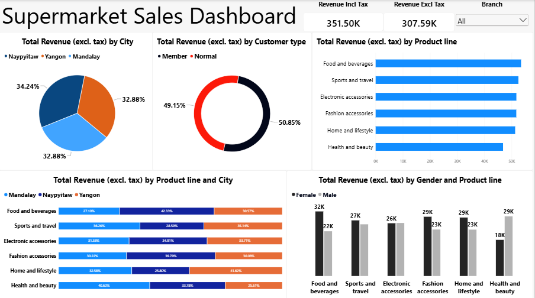

# Supermarket Sales Dashboard | Power BI

An interactive Power BI dashboard built to analyse supermarket sales performance, customer purchasing patterns and product line revenue. Created as part of my data analysis course at IHIFIX.

## Project Overview
This project uses supermarket sales data to explore business performance across cities, product lines, customer types and gender. The dashboard shows revenue both with and without tax, so the real earnings of the business are clear.

An Excel version of this project is available here: [Supermarket Sales Dashboard | Excel](https://github.com/Betsej/Supermarket-Sales-Dashboard).

## Business Problem
Supermarkets generate a lot of sales data across products, locations and customer groups. Without a clear summary, it is hard to see which products perform best, which cities earn the most and how different customers contribute to sales.

This project organises the data into one dashboard that makes these patterns easy to see.

## Project Objectives
- Compare revenue with and without tax.
- Analyse revenue by city and product line.
- Examine purchasing patterns by customer type and gender.
- Explore each branch using a filter.
- Present the findings in one clear dashboard.

## Tools Used
- Microsoft Power BI
- Microsoft Excel (data cleaning and preparation)
- Data visualisation (pie, donut, bar, column and stacked bar charts)
- Slicers (Branch filter)

## Dashboard Preview

## Key Performance Indicators
- **Revenue Incl Tax:** 351.50K, the total paid by customers.
- **Revenue Excl Tax:** 307.59K, the revenue after tax is removed.

## Key Insights
- **Product performance:** Food and beverages generated the highest revenue, while Health and beauty generated the lowest.
- **City performance:** Revenue is spread almost evenly across the three cities, with Naypyitaw slightly ahead at 34.24%.
- **Customer type:** Members contributed 50.85% of revenue and normal customers 49.15%.
- **Gender:** Female customers spent more in most product lines, while male customers spent more on Health and beauty.

All charts use revenue excluding tax.

## Interactive Features
- Branch filter to explore each location.
- Charts that compare cities, product lines, customer types and gender side by side.
- KPI cards placed next to the charts for easy reading.

## Skills Demonstrated
- Data cleaning and preparation
- Exploratory data analysis
- KPI reporting
- Dashboard development
- Data visualisation
- Business insight generation

## Project Files
- `Supermarket_sales_power bi.pbix` — Power BI file containing the dashboard.
- `Supermarket_Sales_Dashboard_Powerbi.png` — Dashboard preview shown above.
- Excel dataset file (Supermarket_Sales_Powerbi_Data.xlsx).

## Conclusion
This project shows how Power BI can turn supermarket transaction data into a clear dashboard that supports business decisions. It also strengthened my skills in working with structured data, spotting sales patterns and presenting findings clearly.

## Author
Orherime Betty Ejakpovi — Data Analyst | Excel · SQL · Power BI

[LinkedIn](https://www.linkedin.com/in/orherime-ejakpovi) · [Portfolio](https://betsej.github.io/)
